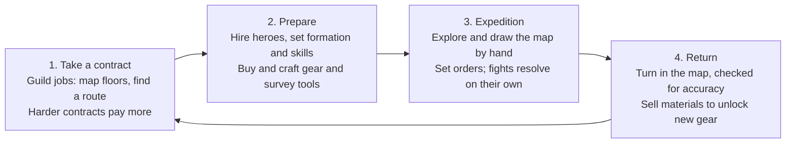

# Cartography Game — Design Doc

_Last updated: 2026-11-13_

## Pitch and pillars

You run a cartographers' guild: hire a party of adventurers, send them into randomly generated dungeons, and draw the map by hand as you explore. Inspired by Etrian Odyssey's mapping, with its combat turned down to a planning layer. Runs on phone and PC.

- **The map is the game.** Drawing it is the main activity, and almost every other system feeds into it or out of it.
- **Plan, don't micromanage.** You set orders before a fight; the fight resolves itself.
- **Every run is new.** Dungeons are generated, so there is always fresh ground to chart.
- **Your party has a story.** Heroes grow along paths you choose and pick up traits from what happens to them.

## Core loop

Each contract sends you deeper; the map you bring back pays for the next, harder run.

## Cartography

The player draws the map by hand on a grid; the game never auto-maps. What you draw is the record you turn in, and it changes how later runs go.

- **Hand drawing.** Place walls, doors, stairs and icons on a grid as the party moves. The game remembers only what the party has seen, so the official map is your work.
- **Accuracy is checked.** When you turn in a map, it is compared with the real layout. Accurate maps pay more; a wrong wall costs you, or hurts the next party that uses it.
- **Notes change play.** Mark a trap and the party walks around it. Marked camp spots let you rest. A marked shortcut makes the next trip faster. Noting enemy types tells you what orders to give before a fight.
- **Survey tools you upgrade.** A better lantern lights more of the grid, a compass shows facing, a rope measures drops. Your mapping improves, not just your heroes.
- **Phone-friendly drawing.** Drawing has to feel good on a touch screen: big grid cells, quick tools, undo. This is the riskiest part of the design to get right.

**UI concepts (draft, see the [UI mockups](https://claude.ai/artifact/L8gF3xVez1WppJxiU2pf3u))**

- **First-person view (working assumption).** Hand drawing only matters if the screen doesn't already show the layout.
- **Phone, exploring:** view on top, party bar, a small map you can draw on, tool row, movement pad.
- **Phone, map mode:** tap the map for a full-screen zoomed editor with an icon picker. Layers for walls and notes.
- **Seen but not drawn:** walls the party has seen show as faint dashed lines until you draw them.
- **Icon set:** treasure, trap, gather, camp, stairs up/down, quicksand, ice slide, enemy, one-way door.
- **PC:** view and party on the left, a large map with a vertical toolbar and a floor-notes list on the right. WASD to move, Q/E to turn, mouse to draw.

## Dungeons and generation

Dungeons are randomly generated, but built from hand-made pieces so every floor has something worth drawing.

- **Templates, not pure noise.** Fully random mazes are boring to map. Generate floors from hand-made rooms and set pieces: puzzles, landmarks, one-way doors, dead ends that hide something.
- **Seeded and persistent.** Each dungeon comes from a seed and stays the same, so your map stays useful across runs and contracts send you deeper over time.
- **Shifting zones (maybe).** A few deep areas could change between runs, giving you a reason to come back and re-map.
- **Locations.** Different places with their own look, enemies, materials and hazards.

**Location ideas**

- **Ice cave.** Slippery floors slide the party until they hit a wall, so working out where a slide ends is part of mapping it.
- **Desert.** Quicksand tiles drop the party to the floor below, a way down you can find by accident or mark and use on purpose.

## Party and combat

You give orders at the start of each fight; the rest plays out automatically. Your choices happen before and around combat, not during it.

- **Hiring.** Recruit adventurers from the guild, each with a class, stats and starting traits.
- **Moving.** You walk the party as one group, as the cartographer travelling with them.
- **Formation.** Front row and back row, and who protects whom.
- **Pre-fight orders.** When a fight starts you see what you face, then set orders: focus a target, use a big skill, play defensive, flee. After that the fight resolves on its own.
- **Scouting pays.** Enemy types you've noted on the map let you plan orders better.
- **Lasting effects.** Fatigue, injuries and supplies carry through a run, so the trip back from a deep floor is tense.

## Hero growth

Heroes grow along paths you choose and pick up traits from what happens to them. These are future ideas, not yet core.

- **Skill paths.** At key levels you choose a direction, such as a mage going toward ice or fire.
- **Paths that touch the map.** Some skills change what you can reach: ice freezes water to cross it, fire burns through vines. Your build affects which parts of a dungeon you can chart.
- **Traits from events.** Heroes gain traits from what happens on runs. Surviving a cave-in might give *Claustrophobic* or *Steady Nerves*.
- **Relationships.** Heroes who run together often build bonds that unlock pair bonuses or combo moves, so replacing a veteran is a real decision.

## Crafting and economy

Crafting stays light, in the Etrian style: selling materials unlocks new gear in the shop, with no recipe menus to work through.

- **Materials** come from monsters and gathering spots.
- **Gathering spots are map icons.** They refill between runs, so a good map tells you where to farm.
- **Mapping gear is craftable too:** better ink, survey tools, camp kits, alongside weapons and armour.
- **Income** comes mostly from contracts and the maps you turn in; it pays for hiring, gear and supplies.

## Decisions and open questions

**Decided**

- The player draws the map by hand.
- Combat: orders at the start of each fight, then automatic.
- Dungeons are randomly generated.
- Runs on phone and PC.

**Open questions**

- [ ] First-person exploration like Etrian, or top-down?
- [ ] How much does an inaccurate map cost: just pay, or real danger for later parties?
- [ ] Permadeath for heroes, or only injuries?
- [ ] How many heroes in a party, and how many on the guild roster?
- [ ] Is there a story or setting, or is it a pure contract loop?

**Parking lot (future ideas)**

- Relationships between heroes
- Traits heroes gain from events
- Skill paths (e.g. ice vs fire mage)
- Shifting dungeon zones

## Tech (to discuss)

The current leaning is a web stack in TypeScript, so one codebase runs on phone and PC. Not decided yet.

| Option | Strengths | Weaknesses |
| --- | --- | --- |
| Web: TypeScript + Phaser, or PixiJS/Canvas with React or Svelte for UI | Runs in any browser; can become an offline PWA; wrap with Capacitor for app stores and Tauri or Electron for Steam; familiar stack | No visual editor; you build more tooling yourself |
| Godot | Full editor; easy path to 3D later | Web export is heavier and less smooth in phone browsers |
| Unity | Mature, huge ecosystem | Overkill for a grid-based 2D game |
