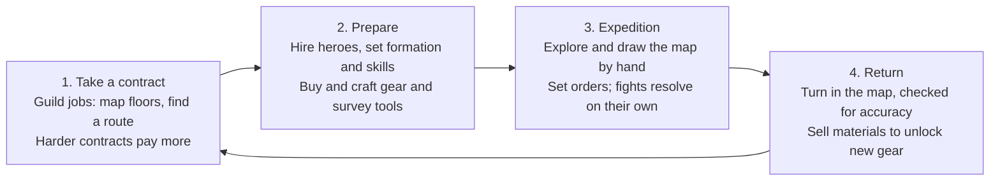

# Cartography Game — Design Doc

_Last updated: 2026-11-13_

## Pitch and pillars

You run a cartographers' guild: hire a party of adventurers, send them into randomly generated dungeons, and draw the map by hand as you explore. Inspired by Etrian Odyssey's mapping, with its combat turned down to a planning layer. Runs on phone and PC.

- **The map is the game.** Drawing it is the main activity, and almost every other system feeds into it or out of it.
- **Plan, don't micromanage.** You set orders before a fight; the fight resolves itself.
- **Every run is new.** Dungeons are generated, so there is always fresh ground to chart.
- **Your party has a story.** Heroes grow along paths you choose and pick up traits from what happens to them.

## Core loop

Each contract sends you deeper; the map you bring back pays for the next, harder run.

## Cartography

The player draws the map by hand on a grid. The only thing filled in automatically is your footsteps: cells the party walks on. What you draw is the record you turn in, and it changes how later runs go.

- **Footsteps fill in.** Each cell you step on is filled in on your map, as in Etrian Odyssey. Cells you haven't walked stay blank, even ones you can see.
- **Hand drawing.** Place walls, doors, stairs and icons on a grid as the party moves. The game remembers only what the party has seen, so the official map is your work.
- **Walls are lines between cells (decided).** On the map a wall is a bold line on the edge between two cells, as in Etrian Odyssey. Walls are drawn by connecting dots (cell corners): pressing starts a trace that follows the pointer's path from the nearest dot, and a wall is placed only when the line reaches another dot in the same row or column, so a stray touch never leaves a wall. The Pencil and Eraser sit in a toolbox, a box to the left of the map; Pencil is the default. The Eraser rubs out any wall the pointer passes over; undo takes back a whole stroke. Walking across an edge proves it's open, so you can't draw a wall there.
- **Generator vs map walls (prototype).** The generator still builds floors from solid and open cells, and the 3D view shows solid cells as blocks. A real map wall is any edge between an open cell and solid rock, which is what drawn lines are checked against. Thin walls between two open cells (e.g. two rooms sharing one wall) would need the generator to place walls on edges too.
- **Coordinates.** Columns are lettered along the top and rows numbered down the left (A1 is the top-left cell), so notes, contracts and other players can name a spot ("the trap at F12").
- **Accuracy is checked.** When you turn in a map, it is compared with the real layout. Accurate maps pay more; a wrong wall costs you, or hurts the next party that uses it.
- **Notes change play.** Mark a trap and the party walks around it. Marked camp spots let you rest. A marked shortcut makes the next trip faster.
- **Survey tools you upgrade.** A better lantern lights more of the grid, a compass shows facing, a rope measures drops. Your mapping improves, not just your heroes.
- **Phone-friendly drawing.** Drawing has to feel good on a touch screen: big grid cells, quick tools, undo, and a zoomable map (pinch or wheel to zoom, two fingers to pan; a second finger cancels a stroke in progress). This is the riskiest part of the design to get right.

**UI concepts (draft, see the [UI mockups](https://claude.ai/artifact/L8gF3xVez1WppJxiU2pf3u))**

- **First-person view (working assumption).** Hand drawing only matters if the screen doesn't already show the layout.
- **Phone, exploring:** view on top, party bar, a small map you can draw on, tool row, movement pad.
- **Phone, map mode:** tap the map for a full-screen zoomed editor with an icon picker. Layers for walls and notes.
- **Seen but not drawn:** walls the party has seen show as faint dashed lines until you draw them.
- **Icon set:** treasure, trap, gather, camp, stairs up/down, quicksand, ice slide, enemy, one-way door. Icons are added to the toolbox as needed, when the thing they mark comes into the game, not all at once.
- **Town menu (prototype).** The game starts in town: a list of places on the left (Delve, Inn, Shop, Tavern, Smith, Alchemist, Guild hall, then Save) each written on a parchment scroll with an icon beside the name. The right side shows a big picture of a map with a ruler and compasses (a logo may replace it later). Delve enters the dungeon, but only with someone to send: if the party is empty, or everyone in it is down, it stays in town and shows a warning saying to pick heroes in the Guild hall. Guild hall opens the guild screen; the rest are placeholders. Save saves the game and shows "Game saved." for a moment.
- **Saving and loading.** Save in town writes the guild to one save file: every hero (name, class, gender, level, XP, HP, SP, MP, stats, skills, gear, traits) and who is in the party, in order. The game loads it when it starts, so you pick up where you saved. There's one save, and each Save overwrites it. Saving only happens in town: a delve isn't saved, and closing the game mid-delve loses that delve and anything since the last Save. A broken or missing save starts a fresh guild. The file is `save.json` in Godot's user folder (on Windows, `%APPDATA%/Godot/app_userdata/EOClone/`).
- **Guild screen (prototype).** The same scroll list, with Recruit, Manage party, Train and Back to town. Train does nothing for now.
- **Recruit.** Lists every hero class (with its badge). Pressing one hires a random level 1 hero of that class (random name and gender) into the guild; the right side says who joined and lists the guild's heroes. New heroes join the guild, not the party. Heroes stay in the guild between delves, keeping their HP and XP, and are kept when you Save.
- **Manage party.** Two lists side by side: the guild's other heroes on the left, the party on the right, each line showing the class badge, name, level and HP. Click a hero to pick them, then the → arrow moves them into the party and ← moves them out Dragging a hero onto the other list moves them too, and so does a double-click. The party holds at most 5 heroes; when it's full the → arrow is greyed out and drops are refused, and the heading shows the count (Party 3/5). A delve takes every party hero who isn't down. In town, the party's hero cards show at the bottom left of the picture.
- **Party cards layout.** Hero cards sit in one row when they fit. If not, they stack like a pyramid, the smaller half on top: 2 over 3 for five heroes, 2 over 2 for four, 1 over 2 for three. Cards narrow to fit the bottom row, and narrow cards drop the class from the title (the badge still shows it). In the dungeon the 3D view gets shorter to make room. With no heroes you can still explore and map, but no monsters appear.
- **PC:** view and party on the left, a large map with a vertical toolbar and a floor-notes list on the right. W/S to move, Q/E to strafe, A/D to turn (hold to keep stepping), mouse to draw.

## Dungeons and generation

Dungeons are randomly generated, but built from hand-made pieces so every floor has something worth drawing.

- **Templates, not pure noise.** Fully random mazes are boring to map. Generate floors from hand-made rooms and set pieces: puzzles, landmarks, one-way doors, dead ends that hide something.
- **Floor size.** A floor is at most 26 × 26 cells, so map columns run A to Z.
- **Stairs.** Stairs up are set into a wall: the party starts on the floor in front of them, facing into the room, as if just arrived from above. The way down is a trapdoor in the floor of another random room. In the 3D view the stairs are a picture on the wall and the trapdoor a picture on the floor; the theme file picks both. Floors are numbered below town: -1, -2, -3. Stepping onto the trapdoor asks "Go deeper?"; walking into the stairs up asks "Go up?". Saying No (or just standing there) leaves a "Delve deeper" button while you're on the trapdoor, and a "Go up" button while you're in front of the stairs. Going down you arrive in front of the stairs up; going up you arrive on the trapdoor. Stairs up from -1 lead out to town; a delve is 3 floors (set in the floor settings), and the trapdoor on the last floor also takes you back to town. Each floor keeps the map you drew there for the whole delve. Each floor's seed comes from the delve's seed, so a delve is the same every time.
- **Boss and rewards at the end of a delve (idea).** The last floor of each delve ends with a boss. Beating it gives extra loot for finishing the dungeon, and mapping the delve out (a full, accurate map) earns extra rewards on top.
- **Long delves (idea).** Some delves are too long to finish in one trip and branch into several paths. You come back to them again and again, so your maps carry over between trips: what you charted last time is still there, and keeping a good map is what lets you push further each time.
- **Wall torches.** Animated torches hang on random walls, spread a few cells apart, each lighting the area around it with a flickering light that stops at walls. How many and how far apart is set in the floor settings; the art comes from the theme.
- **Premade floors mixed in (idea).** Now and then a whole hand-made floor appears among the generated ones, as a landmark or a puzzle floor.
- **Seeded and persistent.** Each dungeon comes from a seed and stays the same, so your map stays useful across runs and contracts send you deeper over time.
- **Shifting zones (maybe).** A few deep areas could change between runs, giving you a reason to come back and re-map.
- **Day and night (idea).** A day and night cycle changes what you meet and what's open: different enemies or events by night, some places only reachable at one time.
- **Locations.** Different places with their own look, enemies, materials and hazards.

**Location ideas**

- **Ice cave.** Slippery floors slide the party until they hit a wall, so working out where a slide ends is part of mapping it.
- **Desert.** Quicksand tiles drop the party to the floor below, a way down you can find by accident or mark and use on purpose.

**Secrets and breakable terrain**

- **Destroying blocks.** Some walls can be broken with tools or skills to open shortcuts or hidden rooms. The map changes, so your drawing has to be updated.
- **Secret passages (idea).** Hidden passages that go one way or both ways. A one-way passage is worth marking, since you can't come back through it.
- **Ping items.** Items or skills send out a pulse that briefly reveals nearby secrets: hidden doors, buried chests, traps. Mark them on the map before the reveal fades.
- **Locked and breakable doors and chests (idea).** Doors and chests can be locked, needing a key, a lockpick or a skill, or broken open by force. Breaking is quicker but noisy or costly; a locked door you can't open yet is worth marking on the map to come back to. Doors are left out of the first generator prototype and come back with this.

## Party and combat

You give orders at the start of each fight; the rest plays out automatically. Your choices happen before and around combat, not during it.

- **Hiring.** Recruit adventurers at the guild, each with a class, stats and starting traits (see Recruit under the town menu).
- **Moving.** You walk the party as one group, as the cartographer travelling with them.
- **Formation.** Front row and back row, and who protects whom.
- **Random encounters.** Each step has a chance of meeting a monster: for now 25%, always a skeleton (set in `data/generation/encounters.json`). Rolls use a seed from the floor, so a delve meets the same monsters if walked the same way. Taking the trapdoor or jumping on the map with the Move tool never triggers one. Later each dungeon gets its own monster list, with odds for each monster.
- **Monster groups.** A monster can come in a group: for now a skeleton comes alone 60% of the time, as 2 skeletons 30%, and as 3 skeletons 10% (`group_chances` in `data/generation/encounters.json`). Monsters in a group are lettered (Skeleton A, B, C) so the log can tell them apart. Their cards stand side by side over the 3D view under a heading ("3 Skeletons appear!"), and shrink to fit the more there are. Each card hops, shakes and fades on its own, and beating the group gives the XP of every monster in it.
- **Starting a fight.** When monsters appear, their cards show over the view with a **Battle** button; the fight starts only when you press it. The fight then plays out on its own and a **battle log** opens over the map, listing every round and move (who hit whom, for how much, HP left, who went down) and the result. The log plays back one move at a time: HP bars drop as hits land, and Skip shows the rest at once. The monster stays in view with its HP through the fight, and fades when it goes down; it leaves when the log is closed. Attackers hop toward the other side (a hero's card up, the monster down) and whoever is hit shakes side to side. For now every move is a basic attack. Winning gives each standing hero the monsters' XP. If the party falls, the log's button takes you back to town, and every fallen hero is carried back with 1 HP. Damage carries on after the fight.
- **Pre-fight orders.** When a fight starts you see what you face, then set orders: focus a target, use a big skill, play defensive, flee. After that the fight resolves on its own.
- **Lasting effects.** Injuries and supplies carry through a run, so the trip back from a deep floor is tense.
- **Fatigue (idea, later).** The party tires as it walks, so a long trip wears it down. Not part of the first combat build; it may be its own bar or drain stamina.
- **Sleeping at camp (idea).** The party can sleep at a camp spot to recover, but risks an ambush while asleep. Safer marked camp spots make the risk smaller.

## Heroes

Each hero in the party has a sheet. Heroes live in data (save files and the guild roster), not in code.

- **Name.** Shown in the party bar and the fight log. Picked at random from a name list in a data file; you can rename a hero.
- **Gender.** Male, female or unspecified. Sets the portrait and how the game refers to the hero.
- **Class.** Sets starting values and which skills a hero can learn. Classes live in a data file. None are designed yet.
- **HP (red).** Health. At 0 the hero is down for the rest of the fight. Restored at the inn.
- **SP (green).** Stamina, spent on physical skills.
- **MP (blue).** Magicka, spent on spells. Recovers slowly; fully restored at the inn.
- **Defense (DEF).** A percentage cut to damage taken: DEF 20 means a hit does 20% less.
- **Basic attack.** Every hero has one: a damage range, rolled with the fight's seed, before the target's DEF. Weapons add to it later.
- **Speed.** Turn order in a fight: highest acts first. Ties are broken by a seeded roll, so a fight replays the same way. This is a placeholder; a better turn order is an open question.
- **Aggro.** How likely enemies are to target this hero: the chance is the hero's aggro divided by the whole party's aggro. Skills can raise it (a taunt) or lower it (hiding).
- **Skills.** Two lists: **combat** skills, used through the pre-fight orders, and **exploration** skills, used in the dungeon (spot traps, pick locks, a light that shows more of the grid, a pulse that reveals secrets).
- **Level and XP.** Heroes start at level 1. For now every level costs 100 XP and a level changes nothing else; how XP is earned and what a level gives are worked out later in Phase 2.
- **Gear (later).** Equipment slots come with loot and crafting. The sheet keeps room for them.
- **Traits (later).** Kept as an empty list for now, so saves don't break when traits arrive.

### Classes

Each class is a file in `data/classes`, holding its starting numbers and skills. A new hero starts at level 1 with full bars.

- **Warrior.** Stands in front and takes the hits. HP 20, SP 10, MP 0, DEF 5, speed 5, aggro 10, basic attack 4–6. No skills yet.
  - **Power Strike (idea).** Costs SP; a harder hit.
  - **Taunt (idea).** Costs SP; raises the warrior's aggro for the fight.

## Monsters

Monsters share the fight half of the hero sheet: HP, SP, MP, DEF, speed, aggro, a basic attack, combat skills and a level. Heroes and monsters use the same rules for damage, DEF, targeting by aggro, and one shared turn order.

- **Aggro works both ways.** Heroes pick which monster to hit by the monsters' aggro, the same way monsters pick heroes.
- **Types.** Each monster type is a file in `data/monsters`, holding its name, picture, starting numbers and rewards. A starting number can be a range, like HP 5–10, rolled with the floor's seed when the monster is made, so two of the same type can differ.
- **Rewards.** Beating a monster gives the party its XP and its loot. Loot is a list of item ids, empty until items arrive.
- **Not on monsters:** gender, class, exploration skills, gear and traits.
- **Open:** what a monster's level changes, and how XP is split across the party.

### Monster types

- **Skeleton.** Level 1, HP 5–10, SP 0, MP 0, DEF 0, speed 3, aggro 5, basic attack 1–3. No skills. Gives 5 XP, no loot yet.

## Hero growth

Heroes grow along paths you choose and pick up traits from what happens to them. These are future ideas, not yet core.

- **Skill paths.** At key levels you choose a direction, such as a mage going toward ice or fire.
- **Paths that touch the map.** Some skills change what you can reach: ice freezes water to cross it, fire burns through vines. Your build affects which parts of a dungeon you can chart.
- **Traits from events.** Heroes gain traits from what happens on runs. Surviving a cave-in might give *Claustrophobic* or *Steady Nerves*.
- **Relationships.** Heroes who run together often build bonds that unlock pair bonuses or combo moves, so replacing a veteran is a real decision.

## Crafting and economy

Crafting stays light, in the Etrian style: selling materials unlocks new gear in the shop, with no recipe menus to work through.

- **Materials** come from monsters and gathering spots.
- **Gathering spots are map icons.** They refill between runs, so a good map tells you where to farm.
- **Camp crafting (idea).** A small set of things can be crafted at camp during a run, more limited than in town.
- **Mapping gear is craftable too:** better ink, survey tools, camp kits, alongside weapons and armour.
- **Income** comes mostly from contracts and the maps you turn in; it pays for hiring, gear and supplies.

## Decisions and open questions

**Decided**

- The player draws the map by hand.
- Combat: orders at the start of each fight, then automatic.
- Dungeons are randomly generated.
- Runs on phone and PC as installed apps. Engine: Godot.

**Open questions**

- [ ] First-person exploration like Etrian, or top-down?
- [ ] How much does an inaccurate map cost: just pay, or real danger for later parties?
- [ ] Permadeath for heroes, or only injuries?
- [ ] How many heroes in a party, and how many on the guild roster?
- [ ] Is there a story or setting, or is it a pure contract loop?
- [ ] A better turn order. For now it's fastest first, with ties broken by a seeded roll. Ideas to look at: some randomness on every turn, fast heroes acting more often (a timeline or initiative bar), or skills and gear that shift the order.

**Parking lot (future ideas)**

- City building: the guild's town grows between expeditions, with buildings that unlock services (phase 7 of the [plan](plan.md), still to design)
- Relationships between heroes
- Traits heroes gain from events
- Skill paths (e.g. ice vs fire mage)
- Shifting dungeon zones

## Tech

**Engine: Godot** (decided 2026-11-15). The game ships as installed apps on phone (Android, iOS) and PC, with Steam as a target.

- **Why Godot:** native phone apps run much better than browser builds, it has a full editor, and its GridMap builds 3D floors straight from a 2D grid.
- **Language:** GDScript recommended. It keeps a browser build possible later; Godot 4 C# projects can't export to the web.
- **Structure:** game rules (grid, movement, generation, map checking) stay separate from the 3D view and the map screen. Content lives in data files.
- **Open:** iOS builds need a Mac with Xcode.
- **Also considered:** web with Three.js (best for playing in a browser), Unity (too heavy for a grid crawler), Phaser (2D only).
