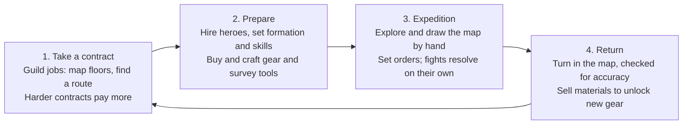

# Cartography Game — Design Doc

_Last updated: 2026-11-13_

## Pitch and pillars

You run a cartographers' guild: hire a party of adventurers, send them into randomly generated dungeons, and draw the map by hand as you explore. Inspired by Etrian Odyssey's mapping, with its combat turned down to a planning layer. Runs on phone and PC.

- **The map is the game.** Drawing it is the main activity, and almost every other system feeds into it or out of it.
- **Plan, don't micromanage.** You set orders before a fight; the fight resolves itself.
- **Every run is new.** Dungeons are generated, so there is always fresh ground to chart.
- **Your party has a story.** Heroes grow along paths you choose and pick up traits from what happens to them.

## Core loop

Each contract sends you deeper; the map you bring back pays for the next, harder run.

## Cartography

The player draws the map by hand on a grid. The only thing filled in automatically is your footsteps: cells the party walks on. What you draw is the record you turn in, and it changes how later runs go.

- **Footsteps fill in.** Each cell you step on is filled in on your map, as in Etrian Odyssey. Cells you haven't walked stay blank, even ones you can see.
- **Hand drawing.** Place walls, doors, stairs and icons on a grid as the party moves. The game remembers only what the party has seen, so the official map is your work.
- **Walls are lines between cells (decided).** On the map a wall is a bold line on the edge between two cells, as in Etrian Odyssey. Walls are drawn by connecting dots (cell corners): pressing starts a trace that follows the pointer's path from the nearest dot, and a wall is placed only when the line reaches another dot in the same row or column, so a stray touch never leaves a wall. The Pencil and Eraser sit in a column on the right of the map; Pencil is the default. The Eraser rubs out any wall the pointer passes over; undo takes back a whole stroke. Walking across an edge proves it's open, so you can't draw a wall there.
- **Generator vs map walls (prototype).** The generator still builds floors from solid and open cells, and the 3D view shows solid cells as blocks. A real map wall is any edge between an open cell and solid rock, which is what drawn lines are checked against. Thin walls between two open cells (e.g. two rooms sharing one wall) would need the generator to place walls on edges too.
- **Coordinates.** Columns are lettered along the top and rows numbered down the left (A1 is the top-left cell), so notes, contracts and other players can name a spot ("the trap at F12").
- **Accuracy is checked.** When you turn in a map, it is compared with the real layout. Accurate maps pay more; a wrong wall costs you, or hurts the next party that uses it.
- **Notes change play.** Mark a trap and the party walks around it. Marked camp spots let you rest. A marked shortcut makes the next trip faster. Noting enemy types tells you what orders to give before a fight.
- **Survey tools you upgrade.** A better lantern lights more of the grid, a compass shows facing, a rope measures drops. Your mapping improves, not just your heroes.
- **Phone-friendly drawing.** Drawing has to feel good on a touch screen: big grid cells, quick tools, undo, and a zoomable map (pinch or wheel to zoom, two fingers to pan; a second finger cancels a stroke in progress). This is the riskiest part of the design to get right.

**UI concepts (draft, see the [UI mockups](https://claude.ai/artifact/L8gF3xVez1WppJxiU2pf3u))**

- **First-person view (working assumption).** Hand drawing only matters if the screen doesn't already show the layout.
- **Phone, exploring:** view on top, party bar, a small map you can draw on, tool row, movement pad.
- **Phone, map mode:** tap the map for a full-screen zoomed editor with an icon picker. Layers for walls and notes.
- **Seen but not drawn:** walls the party has seen show as faint dashed lines until you draw them.
- **Icon set:** treasure, trap, gather, camp, stairs up/down, quicksand, ice slide, enemy, one-way door.
- **Town menu (prototype).** The game starts in town: a list of places on the left (Delve, Smith, Inn, Tavern, Shop, Alchemist, Guild hall) over a plain backdrop, each written on a parchment scroll. Delve enters the dungeon; the others are placeholders. Later the right side shows a picture or the game's logo, with a map-making theme.
- **PC:** view and party on the left, a large map with a vertical toolbar and a floor-notes list on the right. W/S to move, Q/E to strafe, A/D to turn (hold to keep stepping), mouse to draw.

## Dungeons and generation

Dungeons are randomly generated, but built from hand-made pieces so every floor has something worth drawing.

- **Templates, not pure noise.** Fully random mazes are boring to map. Generate floors from hand-made rooms and set pieces: puzzles, landmarks, one-way doors, dead ends that hide something.
- **Floor size.** A floor is at most 26 × 26 cells, so map columns run A to Z.
- **Stairs.** Stairs up are set into a wall: the party starts on the floor in front of them, facing into the room, as if just arrived from above. The way down is a trapdoor in the floor of another random room. In the 3D view the stairs are a picture on the wall and the trapdoor a picture on the floor; the theme file picks both. In the prototype they're scenery: using them comes with multiple floors.
- **Premade floors mixed in (idea).** Now and then a whole hand-made floor appears among the generated ones, as a landmark or a puzzle floor.
- **Seeded and persistent.** Each dungeon comes from a seed and stays the same, so your map stays useful across runs and contracts send you deeper over time.
- **Shifting zones (maybe).** A few deep areas could change between runs, giving you a reason to come back and re-map.
- **Day and night (idea).** A day and night cycle changes what you meet and what's open: different enemies or events by night, some places only reachable at one time.
- **Locations.** Different places with their own look, enemies, materials and hazards.

**Location ideas**

- **Ice cave.** Slippery floors slide the party until they hit a wall, so working out where a slide ends is part of mapping it.
- **Desert.** Quicksand tiles drop the party to the floor below, a way down you can find by accident or mark and use on purpose.

**Secrets and breakable terrain**

- **Destroying blocks.** Some walls can be broken with tools or skills to open shortcuts or hidden rooms. The map changes, so your drawing has to be updated.
- **Secret passages (idea).** Hidden passages that go one way or both ways. A one-way passage is worth marking, since you can't come back through it.
- **Ping items.** Items or skills send out a pulse that briefly reveals nearby secrets: hidden doors, buried chests, traps. Mark them on the map before the reveal fades.
- **Locked and breakable doors and chests (idea).** Doors and chests can be locked, needing a key, a lockpick or a skill, or broken open by force. Breaking is quicker but noisy or costly; a locked door you can't open yet is worth marking on the map to come back to. Doors are left out of the first generator prototype and come back with this.

## Party and combat

You give orders at the start of each fight; the rest plays out automatically. Your choices happen before and around combat, not during it.

- **Hiring.** Recruit adventurers from the guild, each with a class, stats and starting traits.
- **Moving.** You walk the party as one group, as the cartographer travelling with them.
- **Formation.** Front row and back row, and who protects whom.
- **Pre-fight orders.** When a fight starts you see what you face, then set orders: focus a target, use a big skill, play defensive, flee. After that the fight resolves on its own.
- **Scouting pays.** Enemy types you've noted on the map let you plan orders better.
- **Lasting effects.** Fatigue, injuries and supplies carry through a run, so the trip back from a deep floor is tense.
- **Sleeping at camp (idea).** The party can sleep at a camp spot to recover, but risks an ambush while asleep. Safer marked camp spots make the risk smaller.

## Hero growth

Heroes grow along paths you choose and pick up traits from what happens to them. These are future ideas, not yet core.

- **Skill paths.** At key levels you choose a direction, such as a mage going toward ice or fire.
- **Paths that touch the map.** Some skills change what you can reach: ice freezes water to cross it, fire burns through vines. Your build affects which parts of a dungeon you can chart.
- **Traits from events.** Heroes gain traits from what happens on runs. Surviving a cave-in might give *Claustrophobic* or *Steady Nerves*.
- **Relationships.** Heroes who run together often build bonds that unlock pair bonuses or combo moves, so replacing a veteran is a real decision.

## Crafting and economy

Crafting stays light, in the Etrian style: selling materials unlocks new gear in the shop, with no recipe menus to work through.

- **Materials** come from monsters and gathering spots.
- **Gathering spots are map icons.** They refill between runs, so a good map tells you where to farm.
- **Camp crafting (idea).** A small set of things can be crafted at camp during a run, more limited than in town.
- **Mapping gear is craftable too:** better ink, survey tools, camp kits, alongside weapons and armour.
- **Income** comes mostly from contracts and the maps you turn in; it pays for hiring, gear and supplies.

## Decisions and open questions

**Decided**

- The player draws the map by hand.
- Combat: orders at the start of each fight, then automatic.
- Dungeons are randomly generated.
- Runs on phone and PC as installed apps. Engine: Godot.

**Open questions**

- [ ] First-person exploration like Etrian, or top-down?
- [ ] How much does an inaccurate map cost: just pay, or real danger for later parties?
- [ ] Permadeath for heroes, or only injuries?
- [ ] How many heroes in a party, and how many on the guild roster?
- [ ] Is there a story or setting, or is it a pure contract loop?

**Parking lot (future ideas)**

- City building: the guild's town grows between expeditions, with buildings that unlock services (phase 7 of the [plan](plan.md), still to design)
- Relationships between heroes
- Traits heroes gain from events
- Skill paths (e.g. ice vs fire mage)
- Shifting dungeon zones

## Tech

**Engine: Godot** (decided 2026-11-15). The game ships as installed apps on phone (Android, iOS) and PC, with Steam as a target.

- **Why Godot:** native phone apps run much better than browser builds, it has a full editor, and its GridMap builds 3D floors straight from a 2D grid.
- **Language:** GDScript recommended. It keeps a browser build possible later; Godot 4 C# projects can't export to the web.
- **Structure:** game rules (grid, movement, generation, map checking) stay separate from the 3D view and the map screen. Content lives in data files.
- **Open:** iOS builds need a Mac with Xcode.
- **Also considered:** web with Three.js (best for playing in a browser), Unity (too heavy for a grid crawler), Phaser (2D only).
